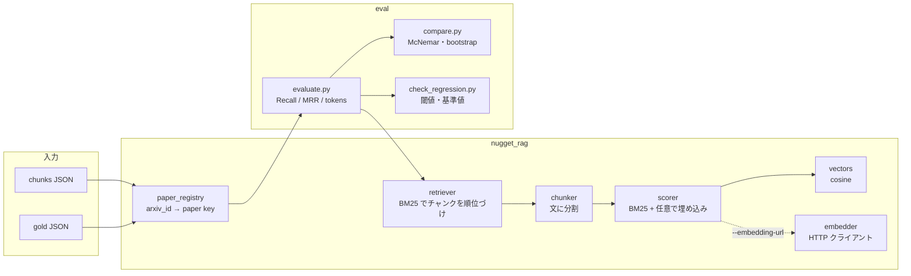

# Design / 設計

内側の構造。外から見た振る舞い（引数・データ形式）は [spec](spec/cli-and-data-formats.md)、判断の理由は [ADR](adr/README.md)。

Internal structure. External behavior (flags, data formats): [spec](spec/cli-and-data-formats.md). Why it is built this way: [ADRs](adr/README.md).

## 何を測るか / What it measures

同じ検索結果の上位チャンクに対し、2 つの返し方を比べる。

- **full-chunk**: 上位 k 件のチャンク全文を返す。
- **nugget**: 上位 k 件のチャンクそれぞれから、クエリに近い文だけ（既定 3 文）を選んで返す。`--nugget-window N` で前後 N 文も付ける。

どちらも、ゴールドの `answer_spans` が返したテキストに含まれるかで Recall@k・MRR@k を数え、語数も測る。
nugget は上位チャンクから文を選ぶ部分集合なので、Recall で full-chunk を上回ることはない（README「限界」）。

## データの流れ / Data flow

1. `evaluate.py` が chunks と gold を検証し、`paper_registry.resolve_paper_key` で論文ごとにチャンクをまとめる。
2. ゴールドの 1 件ごとに、**その論文のチャンクだけ**を対象に検索する（実運用の全論文検索より易しい条件。README「限界」）。
3. `retriever.retrieve_full_chunk` は BM25 の上位 k 件を返す。`retrieve_nuggets` は同じ上位 k 件を `chunker.split_sentences` で文に分け、
   `scorer.top_nuggets` で文を選ぶ。`--embedding-url` があり重みが 0 でなければ、クエリと全文を 1 回のバッチで埋め込み、BM25 と cosine の混合で選ぶ。
4. 返したテキストに `answer_spans` が含まれるかを判定し（`exact` か `normalized`）、モードごとに集計する。
5. `compare.py` が full と nugget の対応あり比較（McNemar の正確確率・bootstrap 区間）を出す。
   判別できる条件は「p < 0.05 かつ Recall 差の 95% 区間が 0 を含まない」で、測定前に固定している。
6. `check_regression.py` は同じ評価を回して、閾値と基準値からの低下を判定する。CI の `eval-regression` ジョブが使う。

## ディレクトリごとの責務 / Responsibilities

| ディレクトリ | 責務 | 依存 |
| --- | --- | --- |
| `nugget_rag/` | 検索と文選びのコア。`retriever`・`chunker`・`scorer`・`vectors`・`embedder`・`paper_registry` | 標準ライブラリのみ |
| `eval/` | 評価 CLI、比較統計、ゴールドと基準値、CLI 共通の引数型（`cli_helpers.py`） | `nugget_rag` |
| `scripts/` | データ取得・プール作成・分析・レポート生成。`eval/cli_helpers.py` を import する | `nugget_rag`・`eval`、`pdftotext`（プール作成のみ） |
| `tests/` | pytest。`tests/fixtures/` は CI の回帰ゲート用の最小データ | |
| `data/` | CI 回帰ゲート用の `chunks_large.json` だけ追跡する。PDF 由来のプールは gitignore | |

## 主な制約と理由 / Constraints

- **実行時の依存ゼロ**（[ADR-002](adr/ADR-002-zero-runtime-dependencies.md)）: BM25 とベクトル演算を自前で持つ。`pyproject.toml` の `dependencies` は空。
  開発ツール（pytest・pytest-cov・ruff）は `dev` extra。
- **スコアリングの層を分ける**: `scorer.py` は `vectors.py`（純粋な計算）だけに依存し、HTTP を話す `embedder.py` を import しない。埋め込みの実装を替えても `scorer.py` は変わらない。
- **`arxiv_id` を安定した識別子にする**: 内部の `paper_id` は検索 API 側の DB 再構築で変わりうるため、ゴールドは `arxiv_id` を持ち、`ARXIV_MAP` で対応づける。
- **回帰ゲートは 2 段**: CI は同梱データで固定閾値 0.95（[ADR-003](adr/ADR-003-gold-set-and-regression-gate.md)）、難問セットはローカルで基準値からの低下幅を助言として見る（README「難問セットの回帰チェック」）。
- **埋め込みの鍵は環境変数のみ**: CLI 引数に置くと `ps` やログに残るため。リダイレクトは辿らない（鍵を別ホストへ送らないため）。
- **評価の限界を出力に残す**: `--pool-label` で候補プールの作り方を JSON に残し、`--match normalized` の使用も明示させる。
